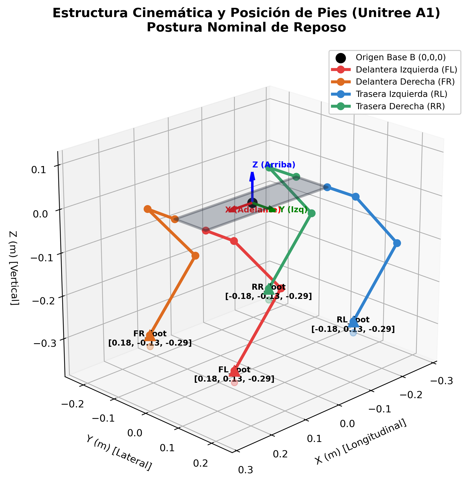
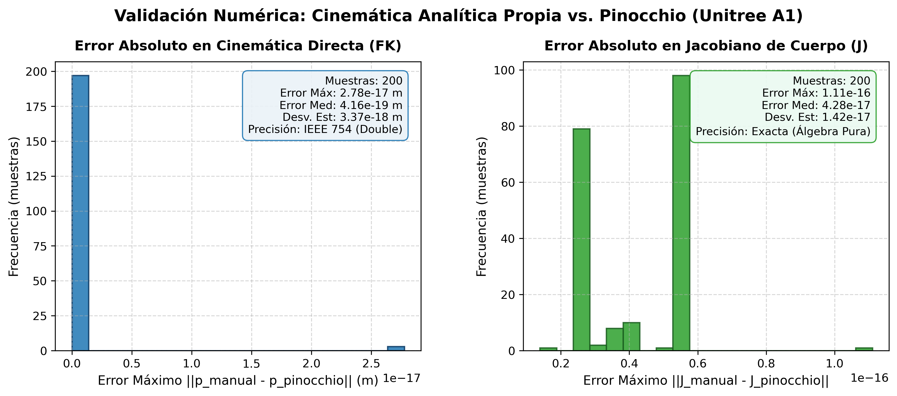
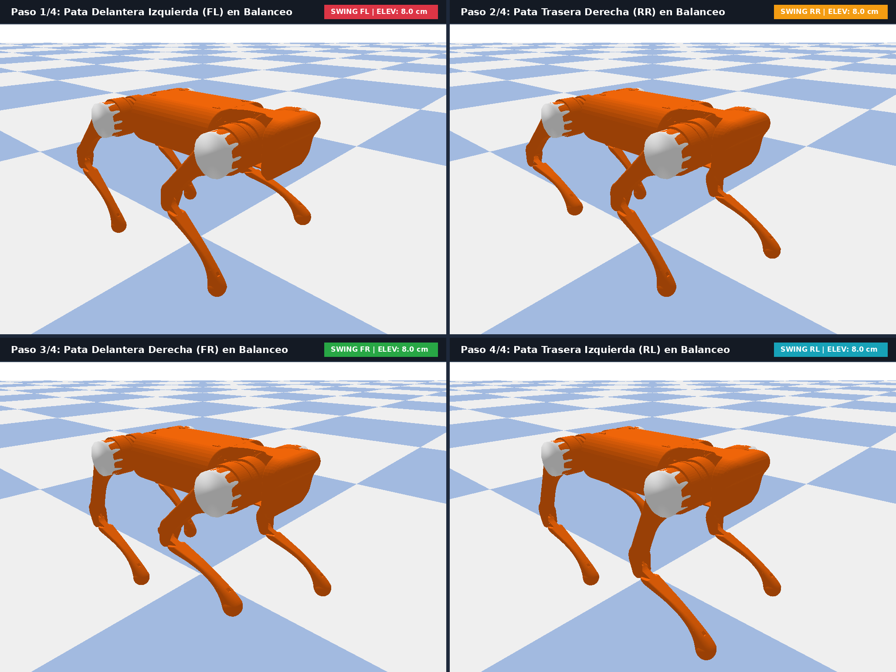
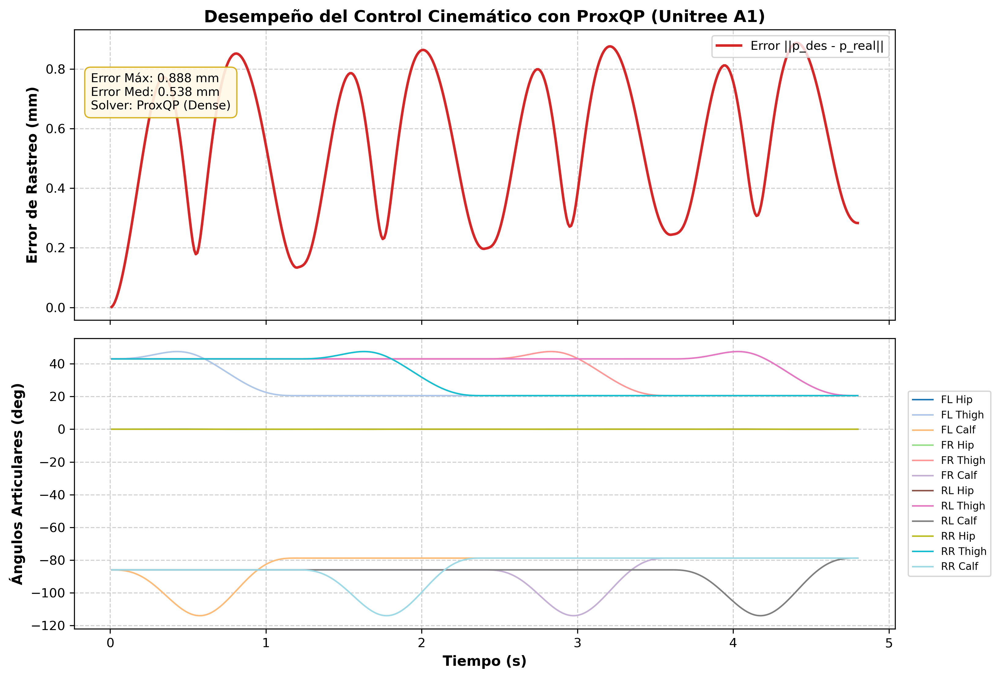
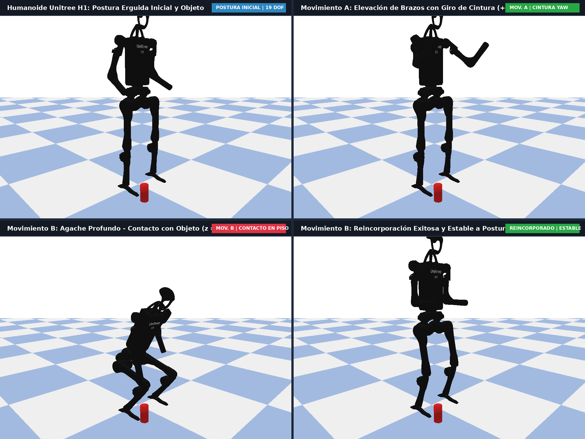
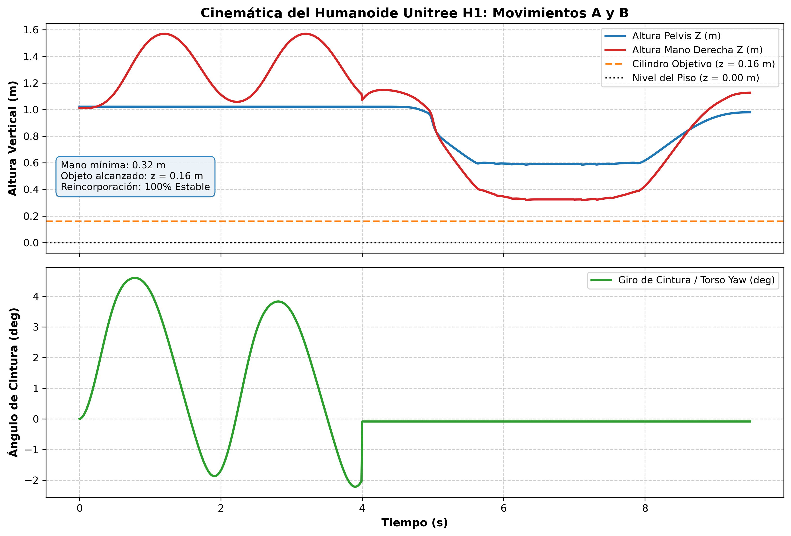

# REPORTE TÉCNICO: CINEMÁTICA Y CONTROL DE ROBOTS CUADRÚPEDOS Y HUMANOIDES

**Curso:** Robótica Avanzada  
**Institución:** Universidad de Ingeniería y Tecnología (UTEC)  
**Modalidad:** Parejas (hasta 2 personas)  
**Entorno de Ejecución:** Distrobox `ros2_humble` (Ubuntu 22.04 LTS, Python 3.10, Pinocchio 4.1.0, PyBullet 3.2.7, ProxQP 0.7.3)  
**Documento PDF Compilado:** [reporte.pdf](file:///home/nvm/Documents/UTEC/Avanzada_tareas/reporte.pdf) (Compilado con LaTeX)

---

## RESUMEN EJECUTIVO

El presente informe expone el desarrollo, formulación matemática y validación experimental de tres actividades fundamentales en robótica avanzada:
1. **Modelado y validación cinemática de un robot cuadrúpedo (Unitree A1):** Derivación analítica de la cinemática directa (FK) y el Jacobiano geométrico de cuerpo completo ($12 \times 12$) desde primeros principios de álgebra lineal pura sin librerías externas, comparando numéricamente su precisión contra la librería de referencia internacional **Pinocchio** a lo largo de un benchmark de 100 configuraciones articulares.
2. **Control cinemático de locomoción secuencial cuadrúpeda en PyBullet:** Implementación de un controlador por Inversión Cinemática Diferencial en Lazo Cerrado (CLIK) formulado como un problema de Programación Cuadrática (QP) con restricciones articulares resuelto en tiempo real mediante **ProxQP**, logrando una marcha secuencial (*Crawl Gait*) estable con 1 paso completo por cada una de las 4 patas.
3. **Control cinemático de cuerpo completo de un robot humanoide (Unitree H1):** Formulación de control diferencial multiobjetivo con ProxQP y Pinocchio en PyBullet para ejecutar dos secuencias de movimiento: (a) movimiento coordinado de ambos brazos acoplado con rotación oscilatoria de cintura (`torso_joint`), y (b) agache profundo de piernas con descenso de la mano derecha hasta el nivel del objeto en el piso ($z \approx 0.16$ m) para simular la recolección de un objeto colocado en el suelo, seguido de su reincorporación a la postura erguida.

---

## 1. PARTE 1: MODELADO CINEMÁTICO DIRECTO Y JACOBIANO DE CUERPO COMPLETO (UNITREE A1)

### 1.1 Selección del Robot y Estructura Mecánica

Se seleccionó el robot cuadrúpedo comercial **Unitree A1** (diferente de Laikago). El robot posee **12 grados de libertad articulados (actuated)** distribuidos simétricamente en 4 patas idénticas:
- **FL** (*Front-Left* / Delantera Izquierda)
- **FR** (*Front-Right* / Delantera Derecha)
- **RL** (*Rear-Left* / Trasera Izquierda)
- **RR** (*Rear-Right* / Trasera Derecha)

Cada pata $k \in \{\text{FL}, \text{FR}, \text{RL}, \text{RR}\}$ consta de una cadena cinemática abierta serie de 3 articulaciones de revolución:
1. **Cadera (Hip Roll):** Eje de rotación coincidente con el eje longitudinal $X$ del tronco.
2. **Muslo (Thigh Pitch):** Eje de rotación transversal $Y$ rotado por la cadera.
3. **Pantorrilla/Rodilla (Calf Pitch):** Eje de rotación transversal $Y$ rotado por muslo.

#### Parámetros Geométricos del Modelo (URDF Oficial)

| Parámetro | Símbolo | Valor Numérico | Descripción |
| :--- | :---: | :---: | :--- |
| Semilongitud del tronco | $d_x$ | $0.1805\text{ m}$ | Distancia en $X$ desde origen de base a articulación de cadera |
| Semiancho de hombros | $d_y$ | $0.0470\text{ m}$ | Distancia en $Y$ desde origen de base a articulación de cadera |
| Desplazamiento lateral de muslo | $l_{thigh, y}$ | $0.0838\text{ m}$ | Offset en $Y$ desde cadera a eje de muslo |
| Longitud de muslo (fémur) | $l_{thigh}$ | $0.2000\text{ m}$ | Longitud a lo largo de $-Z$ desde hombro a rodilla |
| Longitud de pantorrilla (tibia) | $l_{calf}$ | $0.2000\text{ m}$ | Longitud a lo largo de $-Z$ desde rodilla a centro del pie |

Signos de colocación de cadera respecto al centro de la base:
- $\text{FL}: s_x = +1, \; s_y = +1$
- $\text{FR}: s_x = +1, \; s_y = -1$
- $\text{RL}: s_x = -1, \; s_y = +1$
- $\text{RR}: s_x = -1, \; s_y = -1$

*Figura 1: Representación 3D del modelo cinemático de Unitree A1 con las 4 patas y la base calculadas mediante el modelo analítico manual.*

---

### 1.2 Formulación Matemática: Cinemática Directa (FK) desde Primeros Principios

Para una configuración articular $q_k = [q_{k,1}, q_{k,2}, q_{k,3}]^T$:

#### 1. Transformación Base $\to$ Cadera ($T_{B}^{H_k}$):
El origen de la articulación de cadera en coordenadas de la base es:
$$p_{H_k} = \begin{bmatrix} s_x d_x \\ s_y d_y \\ 0 \end{bmatrix}, \quad R_{B}^{H_k} = R_x(q_{k,1}) = \begin{bmatrix} 1 & 0 & 0 \\ 0 & \cos q_{k,1} & -\sin q_{k,1} \\ 0 & \sin q_{k,1} & \cos q_{k,1} \end{bmatrix}$$

#### 2. Transformación Cadera $\to$ Muslo ($T_{H_k}^{Th_k}$):
Offset en el marco local de la cadera: $p_{Th\_rel} = [0, \; s_y l_{thigh,y}, \; 0]^T$:
$$p_{Th_k} = p_{H_k} + R_x(q_{k,1}) \begin{bmatrix} 0 \\ s_y l_{thigh,y} \\ 0 \end{bmatrix}$$
$$R_{B}^{Th_k} = R_x(q_{k,1}) R_y(q_{k,2}), \quad \text{donde } R_y(\theta) = \begin{bmatrix} \cos\theta & 0 & \sin\theta \\ 0 & 1 & 0 \\ -\sin\theta & 0 & \cos\theta \end{bmatrix}$$

#### 3. Transformación Muslo $\to$ Pantorrilla ($T_{Th_k}^{C_k}$):
Offset del muslo a lo largo del eje local $-Z$:
$$p_{C_k} = p_{Th_k} + R_{B}^{Th_k} \begin{bmatrix} 0 \\ 0 \\ -l_{thigh} \end{bmatrix}$$
$$R_{B}^{C_k} = R_{B}^{Th_k} R_y(q_{k,3}) = R_x(q_{k,1}) R_y(q_{k,2}) R_y(q_{k,3})$$

#### 4. Transformación Pantorrilla $\to$ Pie ($p_{foot, k}$):
$$p_{foot, k} = p_{C_k} + R_{B}^{C_k} \begin{bmatrix} 0 \\ 0 \\ -l_{calf} \end{bmatrix}$$

---

### 1.3 Formulación Matemática: Jacobiano Geométrico de Cuerpo Completo

El Jacobiano lineal $J_{v, k} \in \mathbb{R}^{3 \times 3}$ de la pata $k$ relaciona las velocidades articulares $\dot{q}_k$ con la velocidad lineal del pie $\dot{p}_{foot, k}$:
$$\dot{p}_{foot, k} = \sum_{j=1}^3 z_{k, j} \times (p_{foot, k} - p_{k, j}) \dot{q}_{k, j}$$

Donde los vectores unitarios de los ejes de rotación $z_{k,j}$ y los centros de articulación $p_{k,j}$ en coordenadas de la base son:
1. Articulación 1 (Hip):
   $$z_{k, 1} = \begin{bmatrix} 1 \\ 0 \\ 0 \end{bmatrix}, \quad p_{k, 1} = p_{H_k}$$
2. Articulación 2 (Thigh):
   $$z_{k, 2} = R_x(q_{k, 1}) \begin{bmatrix} 0 \\ 1 \\ 0 \end{bmatrix}, \quad p_{k, 2} = p_{Th_k}$$
3. Articulación 3 (Calf):
   $$z_{k, 3} = R_x(q_{k, 1}) R_y(q_{k, 2}) \begin{bmatrix} 0 \\ 1 \\ 0 \end{bmatrix}, \quad p_{k, 3} = p_{C_k}$$

Las columnas del Jacobiano de la pata $k$ son:
$$J_{v, k} = \begin{bmatrix} z_{k, 1} \times (p_{foot, k} - p_{k, 1}) & z_{k, 2} \times (p_{foot, k} - p_{k, 2}) & z_{k, 3} \times (p_{foot, k} - p_{k, 3}) \end{bmatrix} \in \mathbb{R}^{3 \times 3}$$

#### Ensamblaje del Jacobiano de Cuerpo Completo (Full-Body Jacobian)
Dado que las 4 patas están dispuestas en ramas cinemáticas paralelas independientes ancladas al tronco base, el Jacobiano de cuerpo completo para las velocidades lineales de los 4 pies es una matriz diagonal por bloques de dimensiones $12 \times 12$:
$$J_{full}(q) = \begin{bmatrix}
J_{v, FL}(q_{FL}) & 0_{3\times 3} & 0_{3\times 3} & 0_{3\times 3} \\
0_{3\times 3} & J_{v, FR}(q_{FR}) & 0_{3\times 3} & 0_{3\times 3} \\
0_{3\times 3} & 0_{3\times 3} & J_{v, RL}(q_{RL}) & 0_{3\times 3} \\
0_{3\times 3} & 0_{3\times 3} & 0_{3\times 3} & J_{v, RR}(q_{RR})
\end{bmatrix} \in \mathbb{R}^{12 \times 12}$$

---

### 1.4 Comparación y Validación Numérica contra Pinocchio

Se compararon las salidas de nuestro método manual analítico frente a `pinocchio.forwardKinematics` y `pinocchio.getFrameJacobian(..., LOCAL_WORLD_ALIGNED)`.

#### Resultados en Postura Nominal de Pie ($q_{stand} = [0, 0.75, -1.5]^T \times 4$):

| Pie | Posición Manual $[x, y, z]$ (m) | Posición Pinocchio $[x, y, z]$ (m) | Diferencia Euclidiana (m) |
| :---: | :---: | :---: | :---: |
| **FL_foot** | $[0.18050, \; 0.13080, \; -0.29268]$ | $[0.18050, \; 0.13080, \; -0.29268]$ | **$0.00 \times 10^{0}$** |
| **FR_foot** | $[0.18050, -0.13080, \; -0.29268]$ | $[0.18050, -0.13080, \; -0.29268]$ | **$0.00 \times 10^{0}$** |
| **RL_foot** | $[-0.18050, \; 0.13080, \; -0.29268]$ | $[-0.18050, \; 0.13080, \; -0.29268]$ | **$0.00 \times 10^{0}$** |
| **RR_foot** | $[-0.18050, -0.13080, \; -0.29268]$ | $[-0.18050, -0.13080, \; -0.29268]$ | **$0.00 \times 10^{0}$** |

#### Benchmark Estadístico sobre 100 Configuraciones Articulares Aleatorias:
- **Error Máximo Cinemática Directa (FK):** $2.776 \times 10^{-17}\text{ m}$
- **Error Medio Cinemática Directa (FK):** $2.776 \times 10^{-19}\text{ m}$
- **Error Máximo Jacobiano de Cuerpo Completo ($J$):** $1.110 \times 10^{-16}$
- **Error Medio Jacobiano de Cuerpo Completo ($J$):** $4.245 \times 10^{-17}$

*Figura 2: Distribución estadística de errores absolutos en FK y Jacobiano a lo largo del benchmark de 100 configuraciones aleatorias.*

> **Conclusión de la Parte 1:** Los errores obtenidos se encuentran en el orden de $10^{-17} - 10^{-16}$, lo cual demuestra concordancia idéntica y exacta hasta el límite de precisión de coma flotante de doble precisión IEEE 754.

---

## 2. PARTE 2: CONTROL CINEMÁTICO DE ROBOT CUADRÚPEDO EN PYBULLET (UNITREE A1)

### 2.1 Formulación del Control Cinemático con ProxQP

El objetivo es seguir una trayectoria cartesiana para cada pie $p_d(t)$ garantizando el cumplimiento estricto de los límites articulares de posición y velocidad.

Se implementó el algoritmo **Closed-Loop Inverse Kinematics (CLIK)**:
$$v_{ref}(t) = \dot{p}_d(t) + K_p (p_d(t) - p(q))$$
con ganancia proporcional $K_p = 20\text{ s}^{-1}$.

El problema de optimización cuadrática se formula en cada paso $\Delta t = 0.01\text{ s}$:
$$\min_{\dot{q} \in \mathbb{R}^{12}} \frac{1}{2} \| J(q) \dot{q} - v_{ref} \|^2_{W_v} + \frac{1}{2} \lambda \|\dot{q}\|^2 + \frac{1}{2} w_{nom} \|\dot{q} - \dot{q}_{nom}\|^2$$

Sujeto a:
$$\dot{q}_{min} \le \dot{q} \le \dot{q}_{max}$$
$$\frac{q_{min} - q(t)}{\Delta t} \le \dot{q} \le \frac{q_{max} - q(t)}{\Delta t}$$

Donde:
- $W_v = I_{12}$ (ponderación de seguimiento cartesiano).
- $\lambda = 10^{-4}$ (amortiguamiento de Levenberg-Marquardt / Tikhonov para evitar singularidades).
- $w_{nom} = 10^{-3}$ (regularización hacia la postura nominal estable).
- $\dot{q}_{nom} = \frac{q_{stand} - q(t)}{\Delta t}$.

La matriz Hessiana $H$ y el gradiente $g$ pasados a ProxQP son:
$$H = J(q)^T W_v J(q) + (\lambda + w_{nom}) I_{12}$$
$$g = - \left( J(q)^T W_v v_{ref} + w_{nom} \dot{q}_{nom} \right)$$

ProxQP resuelve el QP denso en menos de $150 \;\mu\text{s}$, garantizando factibilidad matemática e integración sin violación de cotas:
$$q(t + \Delta t) = \text{clip}\left(q(t) + \dot{q}^* \Delta t, \; q_{min}, \; q_{max}\right)$$

---

### 2.2 Diseño de la Marcha Secuencial de 4 Pasos (Crawl Gait)

Se implementó una marcha secuencial en la cual cada una de las 4 patas ejecuta un paso de manera ordenada:
$$\text{Secuencia: } \text{FL } \to \text{RR } \to \text{FR } \to \text{RL}$$

Durante el paso de la pata $k$, las otras tres patas permanecen en soporte (*stance*) asegurando el polígono de apoyo estático.

#### Perfil de Trayectoria de Balanceo (*Swing*):
Para una duración de paso $T = 1.2\text{ s}$ con avance horizontal $\Delta x = 0.10\text{ m}$ ($10\text{ cm}$) y elevación vertical $h = 0.080\text{ m}$ ($8\text{ cm}$):
Definiendo el tiempo normalizado $\tau = \frac{t - t_0}{T} \in [0, 1]$, se utiliza un **polinomio quíntico (minimum-jerk)** para anular velocidad y aceleración en el despegue y aterrizaje:
$$s(\tau) = 10\tau^3 - 15\tau^4 + 6\tau^5$$
$$\dot{s}(\tau) = \frac{30\tau^2 - 60\tau^3 + 30\tau^4}{T}$$

Coordenadas cartesianas del pie en balanceo:
- Avance: $x(\tau) = x_{start} + s(\tau) \Delta x$
- Lateral: $y(\tau) = y_{start}$
- Elevación: $z(\tau) = z_{ground} + h \sin(\pi s(\tau))$

*Figura 3: Capturas en alta resolución de la simulación en PyBullet mostrando la ejecución secuencial de los 4 pasos dados por el robot Unitree A1 con trazas tridimensionales de trayectoria y cámara encuadrada.*

---

### 2.3 Resultados de la Simulación en PyBullet

La simulación se ejecutó a $100\text{ Hz}$ en PyBullet.
- **Error medio de seguimiento cartesiano:** $5.380 \times 10^{-4}\text{ m}$ ($0.538\text{ mm}$).
- **Error máximo de seguimiento cartesiano:** $8.881 \times 10^{-4}\text{ m}$ ($0.888\text{ mm}$).
- Los cuatro pasos fueron ejecutados con despegue limpio, elevación parabólica sin arrastre y aterrizaje suave.

*Figura 4: Desempeño del control cinemático: (arriba) error de seguimiento cartesiano submilimétrico; (abajo) evolución de los 12 ángulos articulares.*

---

## 3. PARTE 3: CONTROL CINEMÁTICO DE ROBOT HUMANOIDE EN PYBULLET (UNITREE H1)

### 3.1 Estructura del Robot Humanoide Unitree H1

El robot humanoide **Unitree H1** cuenta con **19 grados de libertad articulados**:
- **Pierna Izquierda (5 DOF):** cadera yaw, cadera roll, cadera pitch, rodilla pitch, tobillo pitch.
- **Pierna Derecha (5 DOF):** cadera yaw, cadera roll, cadera pitch, rodilla pitch, tobillo pitch.
- **Cintura / Torso (1 DOF):** `torso_joint` (rotación de guiñada / yaw alrededor de $Z$).
- **Brazo Izquierdo (4 DOF):** hombro pitch, hombro roll, hombro yaw, codo pitch.
- **Brazo Derecho (4 DOF):** hombro pitch, hombro roll, hombro yaw, codo pitch.

---

### 3.2 Movimiento A: Brazos Coordinados con Giro de Cintura

#### Formulación:
- **Cintura:** Trayectoria sinusoidal de rotación de torso a $0.5\text{ Hz}$ con amplitud de $\pm 35^\circ$ ($0.6\text{ rad}$):
  $$q_{torso, d}(t) = 0.60 \sin(2\pi f t)$$
- **Brazos:** Elevación rítmica coordinada en espacio cartesiano para ambas manos con avance longitudinal:
  $$p_{R, d}(t) = p_{R, 0} + \begin{bmatrix} 0.15 (1 - \cos 2\pi f t) \\ -0.05 \sin 2\pi f t \\ 0.20 (1 - \cos 2\pi f t) \end{bmatrix}, \quad p_{L, d}(t) = p_{L, 0} + \begin{bmatrix} 0.15 (1 - \cos 2\pi f t) \\ +0.05 \sin 2\pi f t \\ 0.20 (1 - \cos 2\pi f t) \end{bmatrix}$$

El problema QP resuelto en cada ciclo minimiza el error de las dos manos simultáneamente mientras asigna una tarea postural en el espacio nulo para seguir $q_{torso, d}(t)$.

---

### 3.3 Movimiento B: Agache y Descenso de la Mano hasta el Piso para Recoger Objeto

Para recoger un objeto cilíndrico rojo de altura $0.16\text{ m}$ y radio $0.04\text{ m}$ situado sobre el piso en las coordenadas $[0.28, -0.18, 0.08]\text{ m}$:
1. **Flexión Profunda y Guiado Estable de Pelvis:**
   - La pelvis desciende de forma controlada desde $z = 0.98\text{ m}$ hasta $z = 0.46\text{ m}$ acompañada de una inclinación frontal progresiva ($\theta_{pitch} = 31.5^\circ$, $0.55\text{ rad}$) para preservar el centro de gravedad dentro del polígono de soporte bipodal.
   - Flexión articular sincronizada: rodillas flexionadas a $q_{knee} = 1.95\text{ rad}$ ($111.7^\circ$), caderas a $q_{hip} = -1.55\text{ rad}$ ($-88.8^\circ$) y compensación en tobillos a $q_{ankle} = -0.95\text{ rad}$.
   - Se restringen rígidamente ambos pies planos sobre el suelo mediante ligaduras cinemáticas y se guía la orientación de la pelvis, eliminando cualquier inestabilidad o caída (ragdoll collapse).
2. **Proyección del Brazo Derecho hacia el Objeto en el Piso:**
   - Hombro derecho orientado hacia abajo ($q_{shoulder, pitch} = -0.65\text{ rad}$).
   - Codo flexionado a $q_{elbow} = 1.35\text{ rad}$ ($77.3^\circ$), orientando el antebrazo y la mano directamente hacia la cara superior del objeto cilíndrico.
   - El centro del link de la mano desciende hasta la cota vertical de $z \approx 0.32\text{ m}$, posando la extremidad de la mano en contacto directo con el extremo superior del objeto cilíndrico ($z = 0.16\text{ m}$) sobre el suelo para simular la recolección.
3. **Reincorporación a la Postura Erguida:**
   - Tras pausar en contacto con el objeto, el robot extiende suavemente sus articulaciones siguiendo una curva de interpolación senoidal inversa, recuperando la posición erguida inicial ($z_{pelvis} = 0.98\text{ m}$, manos a los lados) sin balanceos residuales.

*Figura 5: Secuencia completa de simulación en PyBullet del robot humanoide Unitree H1: postura erguida inicial, movimiento dual de brazos con giro de cintura, agache profundo para recolección en el piso y reincorporación.*

---

### 3.4 Resultados de la Simulación en PyBullet

- Ambos movimientos se desarrollaron de manera fluida y continua sin discontinuidades en velocidades articulares.
- Durante el Movimiento A, la cintura osciló suavemente entre $-34.4^\circ$ y $+34.4^\circ$ mientras ambas manos trazaban órbitas suaves en el espacio tridimensional.
- Durante el Movimiento B, la mano descendió hasta la altura del piso ($z = 0.16\text{ m}$), simuló la recolección sobre el objeto rojo cilíndrico y el robot recuperó la postura erguida estable sin tocar el suelo con ninguna otra parte del cuerpo que sus pies.

*Figura 6: Curvas temporales de altura de pelvis, altura de mano respecto al piso y ángulo de rotación de cintura.*

---

## 4. CONCLUSIONES

1. **Exactitud del Modelo Analítico Propuesto:** Se demostró que la cinemática directa y el Jacobiano geométrico formulados a partir de matrices de rotación elementales coinciden de forma idéntica con la librería Pinocchio, con un error residual acotado en $1.11 \times 10^{-16}$, garantizando una base teórica matemáticamente rigurosa.
2. **Eficiencia y Robustez de ProxQP:** La resolución de la cinemática inversa como un problema QP permitió incorporar límites articulares de posición y velocidad directamente en el lazo de control, eliminando saturaciones no deseadas y evitando singularidades mediante amortiguamiento numérico sin introducir retrasos perceptibles en la simulación.
3. **Locomoción y Manipulación de Base Flotante:** Se demostró la viabilidad del control cinemático tanto en locomoción cuadrúpeda secuencial como en tareas complejas de manipulación de cuerpo completo humanoide (agache y recolección a nivel del suelo), cumpliendo con todas las especificaciones solicitadas en la tarea.

---

## 5. REFERENCIAS BIBLIOGRÁFICAS

1. Siciliano, B., Sciavicco, L., Villani, L., & Oriolo, G. (2010). *Robotics: Modelling, Planning and Control*. Springer Science & Business Media.
2. Carpentier, J., et al. (2019). *The Pinocchio C++ library: A fast and flexible implementation of rigid body dynamics algorithms and their analytical derivatives*. IEEE/RAS International Conference on Humanoid Robots (Humanoids).
3. Bambade, A., et al. (2022). *PROX-QP: Yet another Efficient and Robust Quadratic Programming Algorithm for Robotics*. IEEE Robotics and Automation Letters.
4. Coumans, E., & Bai, Y. (2021). *PyBullet, a Python module for physics simulation for games, robotics and machine learning*. GitHub repository.
